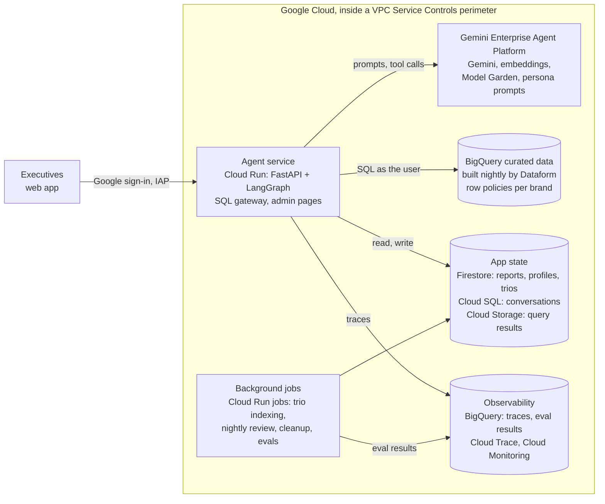
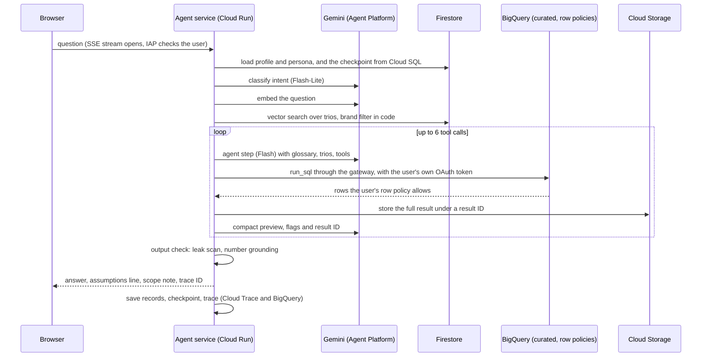

# Architecture

OpsFleet Analyst is a chat agent that lets retail executives ask questions about sales, customers and products in plain words, discuss the answers and turn them into reports. This document is the high-level design for production, then how the prototype in this repository maps onto it.

Decision IDs (D1.1, D6.4, ...) refer to the design log, where each decision records the options considered and why one was chosen.

## Production design

Everything runs on Google Cloud, inside one VPC Service Controls perimeter (D6.13), in the region that holds the company's BigQuery data (D6.14).



The diagram stays at six blocks on purpose (D6.19). Every service is named in the component table below.

### How one chat turn flows



The order of these steps is a graph, not a prompt. The classifier, retrieval and output check are graph edges the model can't skip (D1.10). The agent works in one bounded loop: at most 6 tool calls per turn, repairs included (D1.18, D2.2). Simple turns such as "thanks" or "what tables do you have?" take a light path with no tools (D1.12).

### Components

| Service | What it does | Why (decision) |
|---|---|---|
| Web app | The executive client. Streams answers with Server-Sent Events. The CLI stays an engineer tool. A Google Chat or Slack integration is an extension. | D6.1, D6.10 |
| Identity-Aware Proxy | Gates every request to the service. Access is granted to one group of all agent users. Enabled directly on Cloud Run, with no load balancer. | D6.2, D7.6 |
| Own Google OAuth | Gets a BigQuery-scoped token for the user, so queries run as them and BigQuery applies their row policy. IAP proves who the user is but its header can't call BigQuery. | D6.2, D1.2 |
| Firestore + Cloud KMS (tokens) | Stores each user's refresh token, envelope-encrypted. Only the agent's service account can decrypt, and every decrypt is audited. A fresh access token is minted per turn. | D6.3 |
| Cloud Run service | One service: FastAPI plus the LangGraph graph in the same process, the SQL gateway and the admin pages. One warm instance; request timeout raised for reports. | D6.4, D6.17 |
| Gemini Enterprise Agent Platform | Gemini models: `gemini-3.8-flash` for the agent, planner and writer, `gemini-3.5-flash-lite` for routing and confirmations, `gemini-embedding-001` for trio retrieval. A fallback chain stays inside GCP. Model Garden hosts the cross-family eval judge. Prompt management holds the persona, edited in Agent Studio. | D1.9, D2.10, D4.6, D4.22, D5.6 |
| BigQuery curated dataset | Three tables (`sales`, `customers`, `products`) with no PII copied in. Row access policies per brand, granted to Google Groups. The agent has no access to the raw tables. | D1.2, D1.4, D1.20 |
| Dataform | Rebuilds the curated tables nightly. Reconciliation checks run as assertions and gate publishing. Every answer shows its as-of time. | D1.21 |
| Cloud Identity Groups API | Reads the user's brand groups at sign-in (read-only), so the app and BigQuery use one source of truth for entitlements. | D7.5 |
| Cloud SQL for PostgreSQL | LangGraph checkpoints with the official Postgres saver: conversation state, including pending confirmations. Smallest instance, IAM authentication, 30-day retention. | D6.5 |
| Cloud Storage | Stored query results, one file per result, path built by code from user and session. Deleted after a day by a lifecycle rule. | D6.6 |
| Firestore Enterprise | Reports (versions, soft delete with a TTL purge, audit), user profiles, remembered context items, the trio index with vector search, and full-text search for "reports mentioning X". | D3.10, D4.6, D4.18, D6.8 |
| Google Drive and Docs APIs | Each saved report becomes a Google Doc in a shared drive owned by the agent's service account, shared with its owner only as a commenter. Download, print and copy are off, and sharing stays inside the domain. Deletes trash the Doc and lost brand access removes the user from it, so the Doc follows the app's rules. | D3.13, D3.14, D3.15, D3.23 |
| Cloud Run jobs + Cloud Scheduler + Eventarc | Same image as the service. Scheduler runs the nightly post-session review, checkpoint cleanup and nightly evals. Eventarc runs trio indexing when a trio file lands. | D6.7, D6.9 |
| Cloud Trace + BigQuery (traces) | One OpenTelemetry trace per turn. Spans go to Cloud Trace for the waterfall and to BigQuery for metrics and deep dives. | D2.16, D2.23 |
| Cloud Monitoring | Dashboards for the business and engineering views, plus alerts (leak-scan block, breaker open, job failure). | D2.18 |
| BigQuery (eval results) | `eval_runs` and `eval_cases`, next to the traces, joined by trace ID. | D6.18 |
| Secret Manager | The OAuth client secret. No database password: Cloud SQL uses IAM authentication. | D6.12 |
| Service accounts | One per workload, least privilege. The chat service has no BigQuery data access of its own, since every query runs as the user. | D6.12 |
| VPC Service Controls | A perimeter around BigQuery, Firestore, Cloud Storage, Cloud SQL and the Agent Platform. IAM decides who can read; the perimeter decides where data can go. | D6.13 |
| Cloud Build + Artifact Registry + Terraform | Builds one image, deploys the service and jobs, rolls out gradually. Two projects, staging and prod, from the same Terraform. The eval gate runs in the pipeline. | D6.15, D6.16 |
| Staging project | Evals and test personas run here, against a staging copy of the curated data rebuilt nightly by its own Dataform. | D6.15, D6.20 |
| Pub/Sub | Not used yet: nothing needs one event fanned out to several consumers. Added with the email or Slack extensions. | D6.11 |

### Where state lives

| State | Store | Key | Retention |
|---|---|---|---|
| Conversation checkpoints | Cloud SQL Postgres, official LangGraph saver | conversation | 30 days, scheduled delete job |
| Stored query results | Cloud Storage | `results/{user_id}/{session_id}/{result_id}`, built by code | 1 day, lifecycle rule |
| Refresh tokens | Firestore, Cloud KMS envelope encryption | `user_id` | Until sign-out, a failed refresh or an offboarding revoke |
| Reports, profiles, trio index | Firestore Enterprise | per report, user, trio | Deleted reports purged by TTL 30 days after deletion |
| Remembered context items | Firestore subcollection under the profile | user, item | TTL on the item's expiry |
| Traces, eval results | BigQuery | trace ID, run ID | Traces 30 days |

### Why LangGraph and Gemini

**LangGraph (D1.19).** The design rests on forced steps (classifier, retrieval, output check) around one bounded agent loop. LangGraph's explicit graph makes those steps impossible for the model to skip. Its `interrupt()` and checkpointing give the delete and outline confirmations, and resumable conversations, with little code. Experience: Daniel has shipped LangGraph in production, so delivery risk on a time-boxed build is low. Google's ADK is a credible alternative and would be worth adopting on a long-running project, or if the client standardises on Agent Runtime.

**Gemini (D2.10, D1.9).** The brief prefers newer Gemini models, and running them on the Gemini Enterprise Agent Platform keeps prompts and results inside Google Cloud. Flash does the agent work; Flash-Lite does routing and confirmations, which are frequent and simple. Fallback goes from `gemini-3.8-flash` to `gemini-3.6-flash` to `gemini-3.5-flash-lite`. No external LLM gateway is used, so data never leaves Google's platform.

**One agent, not several (D1.10).** The data is small enough that one agent with a SQL tool keeps the whole conversation in one context and one trace. The upgrade path is an orchestrator with a SQL specialist sub-agent. Split when the schema grows, SQL accuracy needs its own evaluation, tool choice starts going wrong, or context overflows.

## The prototype

The prototype is the same graph and the same rules, run locally from the CLI (D8.3). It creates no cloud services.

| Production | Prototype |
|---|---|
| Web app, IAP, own OAuth | CLI, `--user` picks an entry in `config/users.yaml` |
| BigQuery row access policies on a curated dataset | The gateway injects the three curated tables as `WITH` clauses built from the public tables, already scoped to the user's brands (D1.1, D1.20). Every simulated user shares one credential, so row policies can't tell them apart. |
| Dataform nightly build | The `WITH` tables read the live public tables, so they are never stale. A reconciliation check (`doctor`, and a live test) proves no rows are lost. |
| Gemini on the Agent Platform | Gemini through an AI Studio key, same models and fallback chain |
| Cloud SQL checkpoints | LangGraph's in-memory checkpointer for the session |
| Cloud Storage results | An in-process result store, isolated per session |
| Firestore reports, profiles | One local SQLite file, `reports.db`, behind `ReportStore` and `ProfileStore` interfaces, so production needs only a Firestore adapter (D3.10, D4.25) |
| Google Doc for each saved report | `/download <number>` writes the report as markdown to `reports/`, with its charts, and prints the full path |
| Firestore vector search over trios | A prebuilt index file, `data/golden/index.json`, searched with numpy |
| Prompt management for the persona | Versioned files in `config/persona/`, re-read every turn |
| Cloud Trace and BigQuery | JSONL traces in `traces/`, `python -m analyst trace <id>`, `/stats` |
| BigQuery eval tables | `evals/results/eval_runs.jsonl` and `eval_cases.jsonl` |
| Cloud Build eval gate | GitHub Actions runs the unit tests on every push. It holds no credentials. |

Code layout:

```text
src/analyst/
  cli.py            chat, trace, doctor, eval, golden index and calibrate, persona test
  graph.py          the LangGraph graph: forced steps, the bounded agent loop, report and delete flows
  prompts.py        prompt layers in precedence order: safety, preferences, persona, defaults; glossary and trios
  safety/           classifier (routing only), output check (leak scan, number grounding), decline wording
  sql/              validator, scope rewrite, gateway, empty-result diagnosis, brand matching, curated SQL
  tools/            run_sql, compute (fixed menu), make_chart, report tools
  reports/          planner and writer flow, mentions, delete resolution, reply classifier
  golden/           trio indexing, vector store, retrieval, threshold calibration
  store/            report and profile stores, session result store
  observability/    tracer, trace viewer, /stats
  evals/            eval harness, scoring, runner
config/             settings, users, glossary, analysis defaults, persona versions
data/golden/        seeded trios, labelled set, prebuilt index
evals/              eval sets and the committed baseline
```
